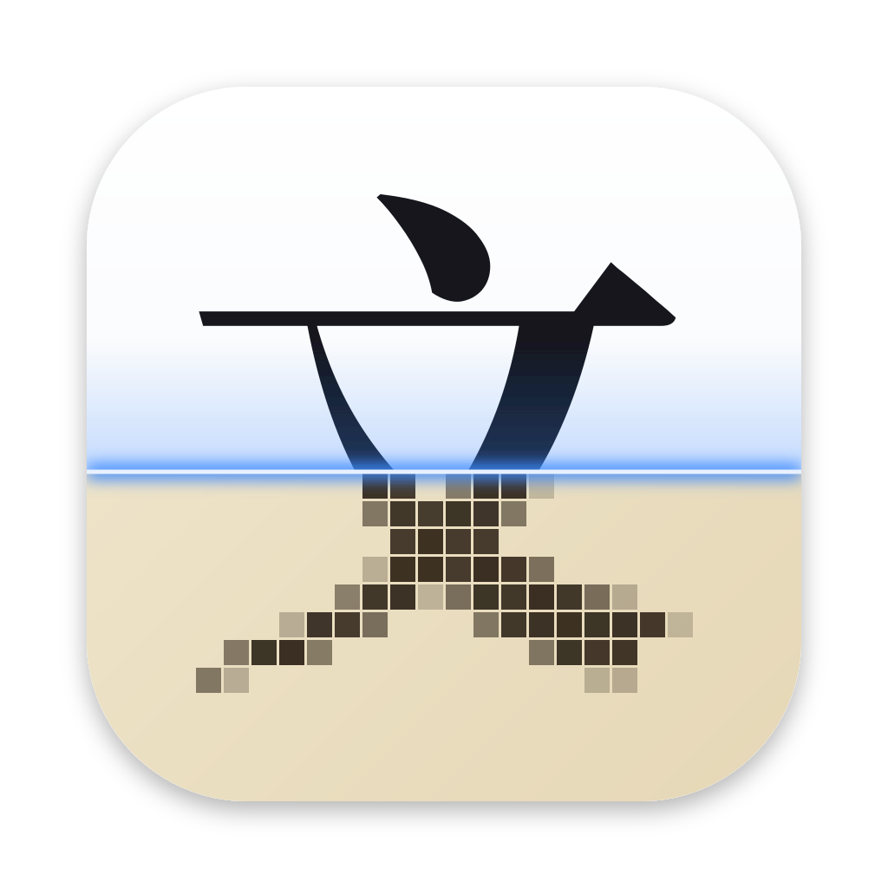

<p align="center">
  
</p>

<h1 align="center">Unscan</h1>

<p align="center">
  <strong>Make scanned PDFs searchable, or retype them into clean text PDFs,
  entirely on your own machine.</strong>
</p>

<p align="center">
  <a href="go.mod"></a>
  
  <a href="LICENSE"></a>
</p>

Unscan is a desktop app and command-line tool that runs OCR on scanned
PDFs. It reads each page with PaddleOCR's **PP-OCRv6 small** models,
run locally through ONNX Runtime, so documents never leave the computer.
It is built for Chinese and English documents, and written in Go without
cgo.

## What it makes

| Output | What you get |
|---|---|
| **Searchable PDF** | The original pages, kept as they are (the scans are not encoded again), with an invisible text layer over them, as [OCRmyPDF](https://github.com/ocrmypdf/OCRmyPDF) does. Search, select and copy work in any PDF viewer, and the file grows by kilobytes only. |
| **Retyped PDF** | Each page redrawn on white paper, its text set in real fonts where it was printed, at the size and in the kind and weight it was printed in, so it reads like a document exported from a word processor. |
| **Text** | The text of every page, as plain text. |

The retyped PDF sets text in Noto Serif SC or Noto Sans SC, regular or
bold, or Noto Serif TC and Noto Sans TC for a document in traditional
Chinese, whose punctuation they center as it is printed, or in LXGW
WenKai for Kai (楷体), the brush-written face of Chinese prefaces and
running heads, or in [fonts of your own](#your-own-fonts).
Pictures, rules and logos are kept as images under the text. Text printed
on color or over a picture, such as a cover's title, stays as printed,
since retyping it would deface the design, with invisible text over it
that keeps it searchable; and so does text that type would not match,
such as handwriting in an illustration or a letter in a box.

## Features

- **Local and private.** OCR runs on your CPU. Nothing is uploaded: the
  app's only connection is its daily check for updates, which Settings
  turns off.
- **Leaves digital pages alone.** Pages that already have text, such as
  born-digital ones, are kept as they are, in both PDFs.
- **Matches the typeface.** Each line's kind (serif, sans-serif or Kai)
  and weight are judged from its strokes, and its size and spacing from
  its ink, so retyped lines land where they were printed. Words set bold
  or italic within a line are set so too, and underlines are kept.
- **Your own fonts.** Set the retyped PDF in any embeddable TrueType font
  or collection, such as macOS's Songti SC or Times.
- **Long documents.** Rendering, OCR and redrawing run as a pipeline, and
  memory does not grow with the document.
- **No cgo.** Everything builds with `CGO_ENABLED=0`: ONNX Runtime is
  loaded at run time with purego, and PDFium runs as WebAssembly.
- **Updates itself.** Signed updates from GitHub releases, in a window
  like Sparkle's, downloading only what changed where it can.
- **Pinned downloads.** Models, fonts and runtimes are fetched at pinned
  versions and checked against their SHA-256.

## Requirements

- Go 1.27.2 or later.
- macOS on Apple silicon to run the app and build its releases. ONNX
  Runtime is also fetched for Linux and Windows (amd64 and arm64) for
  cross-platform builds. Intel Macs are not supported (see
  [Known limitations](#known-limitations-and-roadmap)).
- About 180 MB of models, fonts and runtime, which `cmd/fetchdeps`
  downloads, and about 3 GB of memory while pages are read.

## Getting started

```sh
git clone https://github.com/tacshi/Unscan.git
cd Unscan
go run ./cmd/fetchdeps    # models, fonts and this machine's ONNX Runtime (~180 MB)
go tool mygo dev          # run the app, with live reload
```

`fetchdeps` puts its downloads in `resources/`, which `.gitignore` leaves
out:

```
resources/
├── models/det.onnx            PP-OCRv6_small_det (9.9 MB, Apache-2.0)
├── models/rec.onnx            PP-OCRv6_small_rec (21 MB, Apache-2.0)
├── models/rec_dict.txt        its 18,708 characters, from inference.yml
├── fonts/NotoSerifSC-{Regular,Bold}.ttf  the retyped PDF's serif faces (15 MB each, OFL-1.1)
├── fonts/NotoSansSC-{Regular,Bold}.ttf   and its sans-serif ones (11 MB each, OFL-1.1)
├── fonts/NotoSerifTC-{Regular,Bold}.ttf  in traditional Chinese's forms (10 MB each, OFL-1.1)
├── fonts/NotoSansTC-{Regular,Bold}.ttf   (7.1 MB each, OFL-1.1)
├── fonts/LXGWWenKai-Regular.ttf          and its Kai face, v1.522 (26 MB, OFL-1.1)
├── fonts/*-OFL.txt                       their licenses
└── darwin-arm64/libonnxruntime.dylib  (or linux-*/libonnxruntime.so, windows-*/onnxruntime.dll)
```

For cross-platform builds, fetch ONNX Runtime for other platforms too;
`mygo build` merges the target platform's directory into the app's
resources:

```sh
go run ./cmd/fetchdeps -platforms all                         # every platform ONNX Runtime ships
go run ./cmd/fetchdeps -platforms linux-amd64,windows-amd64   # or some of them
```

## Usage

### Desktop app

Open a scanned PDF with **Choose PDF…**, **File › Open…** (⌘O), by
dropping it anywhere on the window, or with `open -a Unscan scan.pdf`,
even while the models are still loading. The window and the Dock icon
show how many pages have been read and about how long the rest will take.

Open or drop several PDFs, or more while one is read, and they are read
in turn: the sidebar shows the one being read and those waiting, which
✕ takes out of the queue. You can browse the PDFs read meanwhile; each
joins them as it is done. **Cancel** stops the PDF being read and goes
on to the next, and **Cancel All** stops them all.

When it is done, browse the document a page at a time, as the
**Searchable PDF**, the **Retyped PDF** or the **Text**; the arrow keys
turn the pages. **Save…** (⌘S) saves the one shown.

**Compare with Original** (the button beside **Save…**, or **View ›
Compare with Original**) shows the scanned page beside the retyped page
or its text, to check what was read; drag the line between them to
resize them. The searchable PDF looks just like the scan, so it shows
alone.

Every PDF read stays in the sidebar (**View › Hide Sidebar**, ⌥⌘S),
newest first, to open again without reading it again. Its searchable and
retyped PDFs are kept in `history/` in the app's user data folder
(`~/Library/Application Support/Unscan` on macOS) until you remove them:
**Remove from History…** in a row's context menu, or Delete, removes one,
and **Clear…** removes them all. The scans themselves are never touched.

Unscan keeps itself up to date from this repository's GitHub releases.
It checks once a day, and when a new version is out, a window shows its
release notes and offers to install it, skip it or remind you later;
installing downloads only what changed, where it can, and relaunches into
it. **Unscan › Check for Updates…** checks now (on Linux and Windows,
**File › Check for Updates…**). In **Settings…**, **Check for updates
automatically** turns the daily checks off, and **Download and install
updates automatically** installs what they find without asking, for the
next launch. Updates are signed, and Unscan installs only those signed
with its key. It updates itself where it can replace its app, as in
`/Applications`; development builds never do.

### Command line

```sh
go run ./cmd/unscan -o searchable.pdf -txt text.txt -text retyped.pdf scan.pdf
```

The searchable PDF is always written; the text and the retyped PDF are
written when asked for.

| Flag | Default | Description |
|---|---|---|
| `-o` | `<input> (searchable).pdf` | The searchable PDF to write |
| `-txt` | | A text file to write the text to |
| `-text` | | A retyped PDF to write |
| `-resources` | `resources` | The directory of the models, fonts and ONNX Runtime |
| `-dpi` | `300` | The resolution pages are read at |
| `-force` | `false` | Read pages that already have text too |
| `-serif`, `-serif-bold`, `-sans`, `-sans-bold`, `-kai` | built-in fonts | Font files to set the retyped PDF in (see below) |

### Your own fonts

The retyped PDF can be set in your own TrueType fonts instead of the
built-in ones: a `.ttf` file, or one font of a `.ttc` collection, of any
units per em.

- **In the app,** **Unscan › Settings…** (⌘,) chooses a font file for
  each face: serif and sans-serif, regular and bold, and Kai (on Linux and
  Windows, **File › Settings…**). For a collection, the font named Regular
  or Bold, to match the face, is picked, and a menu picks another. The
  choice is kept in `fonts.json` in the app's user data folder, and
  applies to the PDFs read from then on.
- **On the command line,** the fonts are flags, where `file.ttc#n`
  chooses a collection's font *n*, from 0:

  ```sh
  go run ./cmd/unscan -text retyped.pdf \
      -sans /System/Library/Fonts/Supplemental/Arial.ttf \
      -serif /System/Library/Fonts/Supplemental/Songti.ttc \
      -serif-bold '/System/Library/Fonts/Supplemental/Songti.ttc#1' \
      scan.pdf
  ```

Good to know:

- A kind given in one weight only is set in that weight throughout, as
  no bold is synthesized.
- Characters your font lacks, such as Chinese in a Latin font, fall back
  to the built-in font of that face, so Times or Arial can set the Latin
  text of a Chinese book.
- Lines are still measured and judged against the built-in fonts, which
  the judging is tuned to; your fonts only set them.
- Fonts with PostScript (CFF) outlines, as most `.otf` files and most of
  Hiragino are, are refused. So are fonts whose licenses forbid embedding
  (by their OS/2 `fsType`), such as Songti SC Black, since subsets of the
  fonts go into the PDFs.

## Building

```sh
go tool mygo build    # build/darwin-arm64/Unscan.app and a .dmg
```

For macOS, two scripts wrap it:

```sh
scripts/build-mac-debug.sh [--open]   # build/debug/darwin-arm64/Unscan.app, with the native UI inspector
scripts/build-mac-release.sh          # tests, then build/release/darwin-arm64/Unscan.app and its .dmg
```

Both fetch any missing models and runtime first, and target Apple silicon
only; the debug build skips the disk image. The release script reads
these environment variables:

| Variable | Effect |
|---|---|
| `MACOS_SIGNING_IDENTITY` | Signs with this Developer ID identity, with the hardened runtime. Without it the app is signed ad hoc and runs on the Mac that built it only. |
| `NOTARY_PROFILE` | Notarizes the disk image with this keychain profile, made by `xcrun notarytool store-credentials`, and staples the ticket to it and to the app. |
| `MYGO_UPDATER_PRIVATE_KEY` | Signs the update that installed apps download, with this key of `go tool mygo keygen`: the app archived (`unscan-<version>-darwin-arm64.tar.gz`), deltas from the last three versions published, and `update-darwin-arm64.json`, which lists them. |
| `SKIP_TESTS=1` | Builds without running the tests first. |

### Publishing

```sh
scripts/publish.sh 2026.10.0               # build, sign, notarize, review the notes, publish
scripts/publish.sh 2026.10.0 --no-upload   # the signed, notarized disk image in build/publish only
```

`publish.sh` releases from a clean, pushed `main` (`--allow-branch` for
another branch). It builds with the release script, signed with the
keychain's Developer ID and notarized with the `Unscan` keychain profile
(`MACOS_SIGNING_IDENTITY` and `NOTARY_PROFILE` choose others). It then
tags the commit `v2026.10.0` and publishes a GitHub release with the disk
image, as `Unscan-2026.10.0-arm64.dmg`, and the update, which installed
apps find on the latest release. Its notes come from
`release-notes/Unscan-2026.10.0.md` when that exists. Otherwise they are
drafted from the commits since the last release, for you to review or
edit first. The update window shows them too. The version is given to the
build for the run only, so `mygo.json` needs no commit for a release.

The update is signed with the key that `go tool mygo keygen` wrote to
`~/Library/Application Support/mygo/update-keys/mygo-update.key`
(`MYGO_UPDATER_PRIVATE_KEY` gives another), which must be the key of
`updates.publicKey` in `mygo.json`: installed apps accept updates signed
with it only. Keep it out of the repository and backed up, as a lost key
leaves installed apps unable to update, and anyone holding it can ship
code to them.

## How it works

Everything builds with `CGO_ENABLED=0`, as MyGo requires:

| Part | How it runs without cgo |
|---|---|
| OCR models | [ONNX Runtime](https://onnxruntime.ai) 1.27.1, loaded at run time with [purego](https://github.com/ebitengine/purego) through [onnxruntime_purego](https://github.com/getcharzp/onnxruntime_purego) |
| PDF rendering and editing | [PDFium](https://pdfium.googlesource.com/pdfium/) compiled to WebAssembly, run by [wazero](https://wazero.io) through [go-pdfium](https://github.com/klippa-app/go-pdfium) |
| Pre- and post-processing | Go ports of PaddleOCR's text detection (DB) and recognition (CTC) steps |
| Text layer | A small PDF writer with a "glyphless" font, as Tesseract uses |
| Retyped PDF | The same writer, a TrueType subsetter (`internal/ttf`) that embeds just the glyphs used, and PDFium to put the pages together |

Pages go through a pipeline: PDFium renders a page while the models read
the one before, and pages read before that are redrawn for the retyped
PDF on goroutines of their own. The models run a thread per performance
core and are kept busy. PDFium reads the scan from its file as it needs
it, the PDFs made are written to files as they go, and the document is
opened anew every 32 pages to let go of the scans PDFium keeps. So while
pages are read, memory does not grow with the document: it stays at
about 3 GB, mostly the models. A page of dense text takes about 2 seconds on an M1 Pro.

To retype a page, Unscan maps the paper's color to white, measures each
line's ink to a fraction of a pixel, judges its face from its strokes
(voted by paragraph), and sets it so that its glyphs' outlines cover the
ink, spaced out as books are set. What is left that is not white
(pictures, rules, dot leaders) is kept as images; dust and the marks the
scan's edges leave are dropped. Each face is subset to the glyphs used,
and a `ToUnicode` map makes the text copy out as it was read.

[docs/how-it-works.md](docs/how-it-works.md) has the details, step by
step.

## Development

```sh
CGO_ENABLED=0 go test ./...
```

The OCR tests use macOS fonts and skip where those are missing.
[docs/how-it-works.md](docs/how-it-works.md#what-the-tests-check) lists
what each package's tests check.

```
main.go                  the app: state, actions, effects (dialogs, the menu bar, the Dock)
view.go                  the window: the PDF asked for, the progress, the pages in each form, compared
history.go               the PDFs read before: kept on disk, listed in the sidebar, removed
fonts.go                 the user's fonts for retyped PDFs: their fields in Settings, and the choice saved
settings.go              the Settings dialog: the fonts, and whether to check for and install updates
cmd/unscan/              the command line version
cmd/fetchdeps/           downloads and checks the models and runtimes
internal/ocr/            PP-OCRv6: detection, cropping, recognition, reading order
internal/pdfocr/         rendering, the text layer, grafting it onto the PDF, the retyped PDF, and previews
internal/ttf/            TrueType parsing (fonts and collections) and subsetting, for the retyped PDF
internal/testscan/       synthetic scans and scanned PDFs for tests
docs/                    how it works, in depth, and the app icon's source (icon.svg)
```

## Known limitations and roadmap

- **Intel Macs:** Microsoft ships no ONNX Runtime build for them, so
  `darwin/amd64` builds compile but find no runtime. Build one, or read
  pages with Apple Vision on macOS instead (for example through
  [`tmc/apple/vision`](https://pkg.go.dev/github.com/tmc/apple/vision),
  which also uses purego).
- **Reading order** comes from line positions only, so multi-column pages
  interleave in the text output, though the searchable PDF is unaffected.
  A layout model (PP-DocLayoutV3, ONNX) would order them.
- **Orientation:** there is no page or text-line orientation classifier
  yet, so pages scanned upside down read poorly. PaddleOCR's
  `PP-LCNet_x1_0_doc_ori` (ONNX, 6.5 MB) fits the same pipeline.
- **Speed:** OCR runs on the CPU. The CoreML and DirectML execution
  providers are untried; `onnxruntime_purego` binds neither yet.
- **Characters outside the BMP** (such as emoji) are written as two UTF-16
  code units, which some viewers extract as two characters.
- **Retyped PDF:**
  - A line is set in one face, so a bold phrase within a regular line
    comes out as its line is, and italics come out upright.
  - Medium weights come out bold, and display faces, such as a title's
    condensed one, are squeezed into the nearest of the five. FangSong
    comes out Kai, and bold Kai, which LXGW WenKai has no face for,
    regular. Calligraphic lettering on covers,
    such as a publisher's name, often comes out Kai.
  - A face used only for bold lines in a document, with none of its lines
    regular, comes out regular, as there is no body text of its kind to
    judge them against.
  - OCR mistakes show, where the searchable PDF hides them under the
    scan, and characters the recognizer misses (such as some dashes) are
    erased with their line.
  - Vertical text is set rotated, not stacked. Covers and other designed
    pages come out mostly as images, since their text is on color.
- **Your own fonts:** fonts of PostScript outlines (CFF) cannot be used,
  as `internal/ttf` subsets TrueType outlines only; a CFF subsetter, with
  `FontFile3`, would take them. Fonts chosen apply to the PDFs read
  after: setting the retyped PDF again in them means reading the scan
  again, though the lines measured are the same whatever the fonts;
  keeping them would retype the PDF in seconds.

## Acknowledgments

Unscan builds on these projects, under their own licenses:

| Component | License |
|---|---|
| [PP-OCRv6](https://github.com/PaddlePaddle/PaddleOCR) models | Apache-2.0 |
| [ONNX Runtime](https://onnxruntime.ai) | MIT |
| [PDFium](https://pdfium.googlesource.com/pdfium/) | Apache-2.0 / BSD |
| [go-pdfium](https://github.com/klippa-app/go-pdfium), [onnxruntime_purego](https://github.com/getcharzp/onnxruntime_purego), [purego](https://github.com/ebitengine/purego) | MIT / Apache-2.0 |
| [Noto Serif SC](https://fonts.google.com/noto/specimen/Noto+Serif+SC), [Noto Sans SC](https://fonts.google.com/noto/specimen/Noto+Sans+SC), [Noto Serif TC](https://fonts.google.com/noto/specimen/Noto+Serif+TC), [Noto Sans TC](https://fonts.google.com/noto/specimen/Noto+Sans+TC), [LXGW WenKai](https://github.com/lxgw/LxgwWenKai) | SIL Open Font License 1.1 |

The app carries the fonts' licenses in `fonts/NotoSerifSC-OFL.txt`,
`fonts/NotoSansSC-OFL.txt`, `fonts/NotoSerifTC-OFL.txt`,
`fonts/NotoSansTC-OFL.txt` and `fonts/LXGWWenKai-OFL.txt`, and embeds
subsets of the fonts in retyped PDFs, as the license allows. Subsets of
your own fonts are embedded under those fonts' licenses, which are yours
to comply with; fonts that forbid embedding are refused. Check the
dependencies' own terms before you ship.

## License

Unscan is released under the [MIT License](LICENSE). The models, fonts,
runtime and libraries above keep their own licenses.
